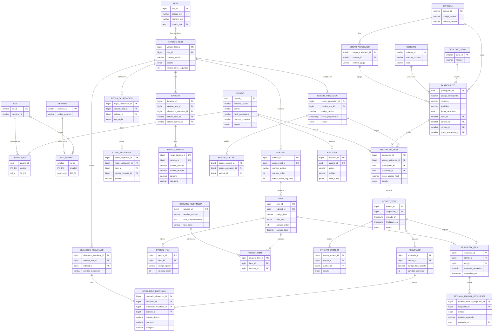
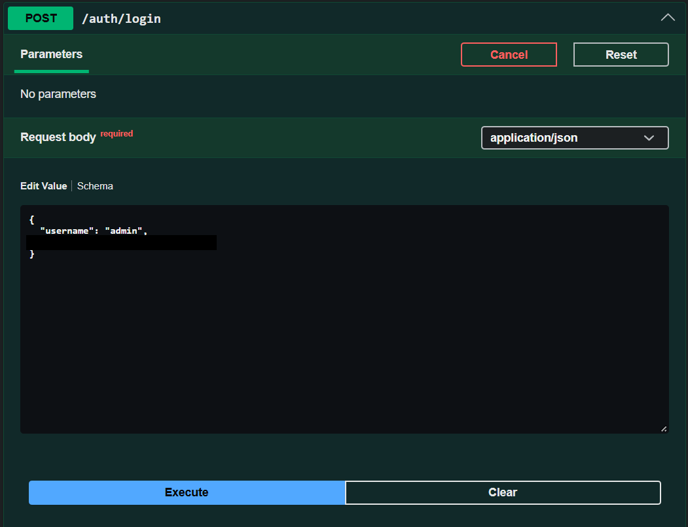
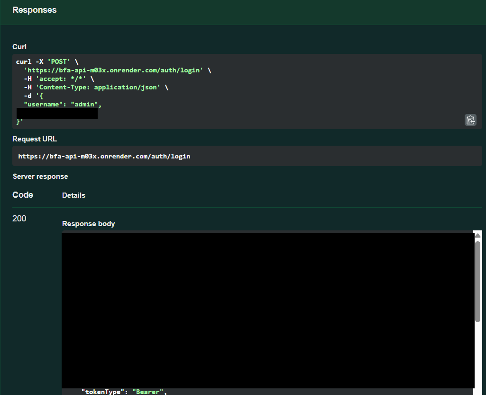
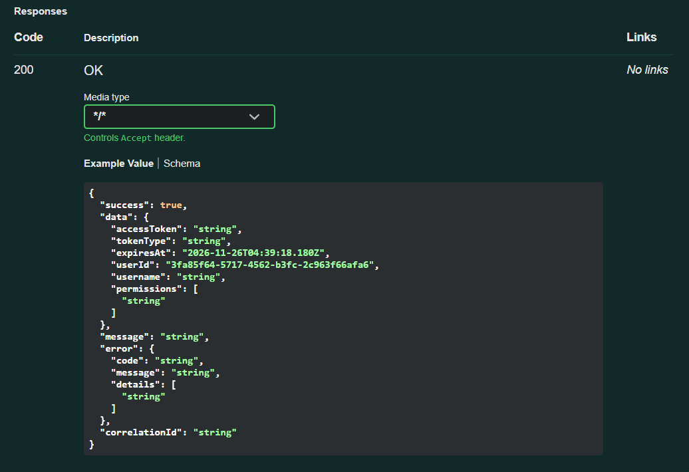
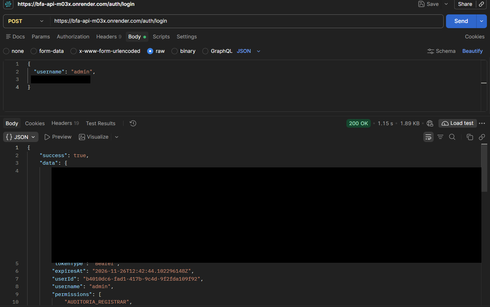

# Taller 4 – Revisión de avances BFA Digital

Repositorio unificado: `backend/` (Spring Boot + PostgreSQL/Supabase) y `frontend/` (React + Vite).
Equipo: Gabriel Pérez, Silvio Mora, Christopher Ibarra.

## 1. Propuesta de base de datos (unificada)

Base de datos PostgreSQL (script completo: `backend/supabase/migrations/20260621000100_create_bfa_schema.sql`).
El diagrama muestra las tablas principales; `PK` = clave primaria, `FK` = clave foránea.

### Cómo el diseño respalda la API

| Módulo de la API | Tablas que usa |
|---|---|
| `/auth`, `/users`, `/roles` | USUARIO, ROL, PERMISO, USUARIO_ROL, ROL_PERMISO |
| `/catalogos`, `/participantes` | CARRERA, COHORTE, CATALOGO_SEXO, GRUPO_ACADEMICO, PARTICIPANTE |
| `/tests`, `/test-versions`, `/subtests`, `/items`, `/baremos` | TEST, VERSION_TEST, SUBTEST, ITEM, OPCION_ITEM, IMAGEN_ITEM, RECURSO_MULTIMEDIA, REGLA_CALIFICACION, CLAVE_RESPUESTA, BAREMO, RANGO_BAREMO |
| `/sesiones` | SESION_APLICACION, SESION_SUBTEST, ASIGNACION_TEST |
| `/evaluacion-participante`, `/intentos` | INTENTO_TEST, INTENTO_SUBTEST, RESPUESTA_ITEM |
| `/attempts/.../score`, `/reports`, `/dashboard` | RESULTADO, RESULTADO_DIMENSION, DIMENSION_RESULTADO |
| `/manual-review` | REVISION_MANUAL_RESPUESTA |
| `/auditoria` | AUDITORIA |

Decisiones clave: las versiones de test son inmutables una vez publicadas (un cambio crea otra versión), la asignación guarda sexo/carrera/cohorte del momento de la aplicación para que los baremos no cambien si el participante cambia de grupo, y cada asignación tiene un único intento y un único resultado (relaciones 1 a 1).

## 2. Funcionalidades acordadas y avance

> Estado marcado por revisión del código (endpoint + pantalla existentes). Antes de presentar, confirmar cada una con una prueba real en Postman.

| # | Funcionalidad | Backend | Frontend | Estado |
|---|---|---|---|---|
| 1 | Autenticación con JWT (login, perfil) | `/auth` | login | Completada |
| 2 | Roles y permisos (RBAC) | `/roles`, `/permissions` | roles | Completada |
| 3 | Gestión de usuarios | `/users` | usuarios | Completada |
| 4 | Catálogos (sexo, carrera, cohorte, grupo) | `/catalogos` | sexos, carreras, cohortes, grupos | Completada |
| 5 | Participantes con paginación | `/participantes` | participantes | Completada |
| 6 | Configuración de instrumentos (test, versión, subtests, ítems, opciones) | `/tests`, `/test-versions`, `/subtests`, `/items` | instrumentos | Completada |
| 7 | Imágenes de ítems y opciones | `/items/.../images` | carga-imagenes | Completada |
| 8 | Reglas de calificación, claves y baremos | `/scoring-rules`, `/answer-keys`, `/baremos` | instrumentos | Completada |
| 9 | Sesiones de aplicación (crear, activar, cerrar, cancelar) | `/sesiones` | sesiones | Completada |
| 10 | Asignaciones y tokens de acceso | `/sesiones/{id}/asignaciones`, `/acceso-participante` | sesiones.asignaciones | Completada |
| 11 | Aplicación al participante con guardado incremental | `/intentos`, `/evaluacion-participante` | evaluación | Completada |
| 12 | Calificación automática | `/attempts/{id}/score` | calificaciones | Completada |
| 13 | Resultados individuales y detalle | `/attempts/{id}/result` | resultados | Completada |
| 14 | Revisión manual | `/manual-review` | revision-manual | Completada |
| 15 | Dashboard y analítica | `/dashboard`, `/analytics` | dashboard | Completada |
| 16 | Reportes PDF / Excel / CSV | `/reports` | reportes | En desarrollo |
| 17 | Auditoría | `/auditoria` | auditoria | Completada |
| 18 | Respaldo y recuperación | `/backups` | respaldos | En desarrollo (la restauración solo registra la solicitud) |
| 19 | Búsqueda y notificaciones | `/search`, `/notifications` | admin-layout | Completada |
| 20 | Publicación de la API y documentación en Swagger UI | Render + Supabase, 103 operaciones documentadas | n/a | Completada |

**Avance: 18 de 20 completadas = 90 %.**

## 3. Evidencias

- Repositorio: https://github.com/Nell16/proyecto-final-BFA
- API publicada: https://bfa-api-m03x.onrender.com
- Frontend publicado: https://proyecto-final-bfa.vercel.app
- Swagger UI: https://bfa-api-m03x.onrender.com/swagger-ui.html
- Colección Postman (importable): `docs/postman/BFA-API.postman_collection.json`
- Login en Swagger UI con la URL publicada (credenciales tapadas):

- Misma prueba en Postman con la URL publicada: 200 OK con la estructura documentada.

## 4. Tareas pendientes y responsables

| Tarea | Responsable |
|---|---|
| Crear la colección Postman con login y las operaciones principales | <asignar> |
| Verificar en Postman que códigos de estado y estructura coinciden con Swagger | <asignar> |
| Terminar la generación de reportes PDF / Excel / CSV | <asignar> |
| Implementar la restauración real de respaldos | <asignar> |
| Revisar pruebas automáticas y datos semilla para la demostración | <asignar> |
